# Northline Job Manager

An internal tool for a fictional landscaping and snow-removal company to track customer quote requests.
Personal portfolio project. **All business names, customers and data are sample data.**

One ASP.NET Core Web API serves three frontends with the same features: **React**, **Blazor** and **Angular**.

## Screenshots: React

| Dashboard | Requests |
|---|---|
| 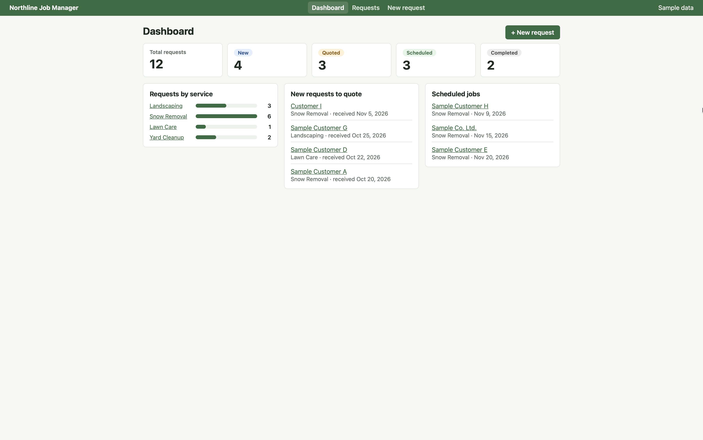 | 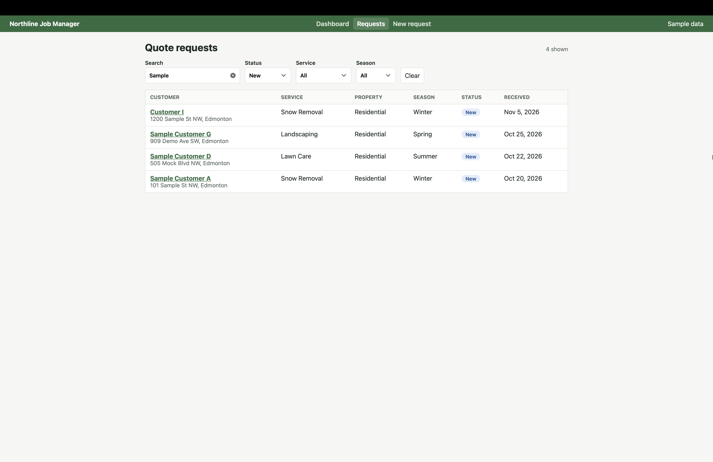 |

| Request details | New request |
|---|---|
| 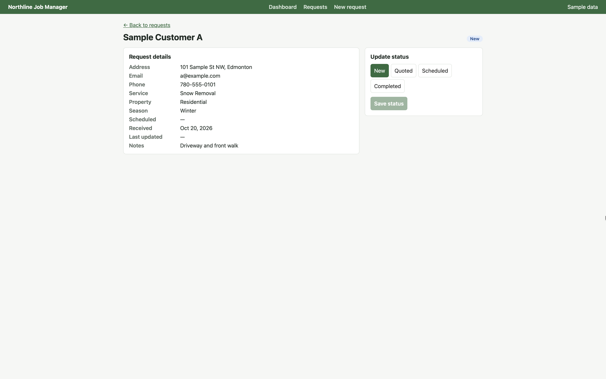 | 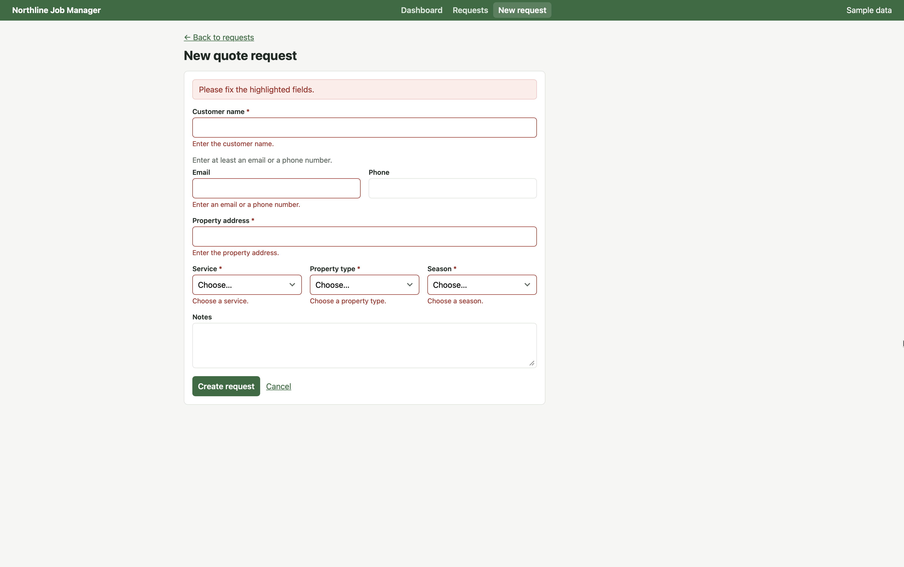 |

## Screenshots: Blazor

| Dashboard | Requests |
|---|---|
| 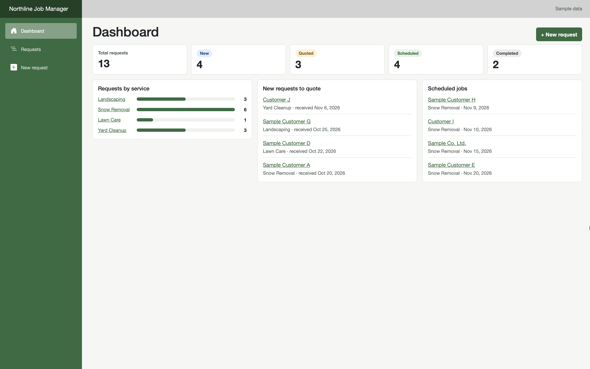 | 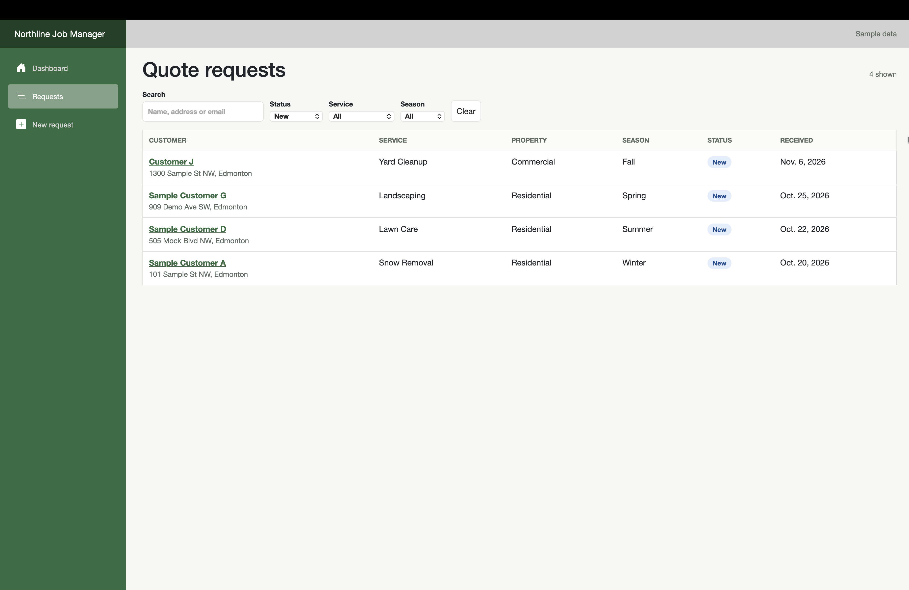 |

| Request details | New request |
|---|---|
| 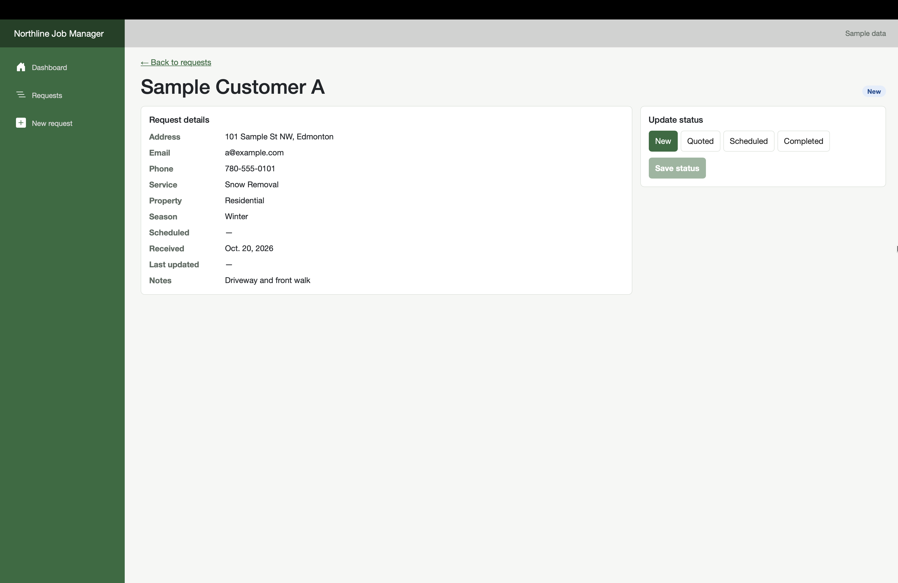 | 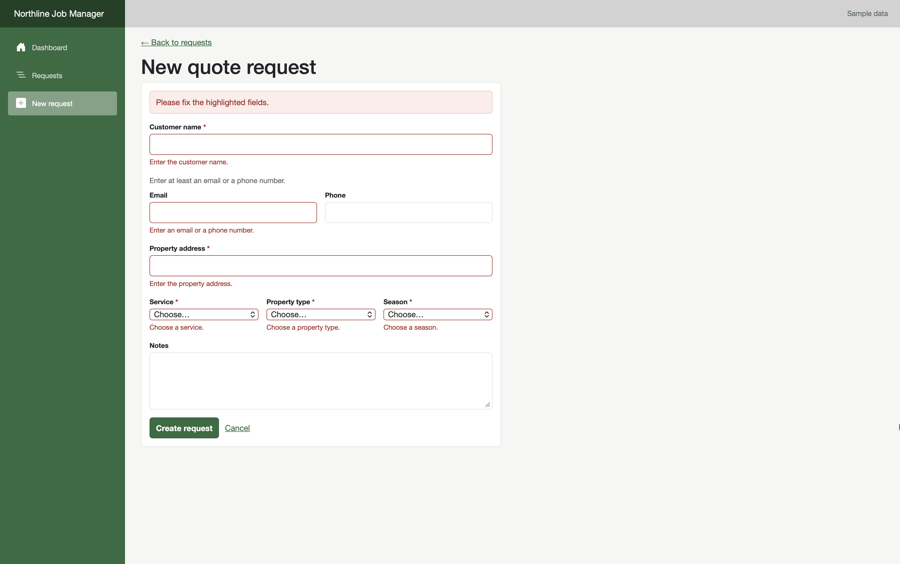 |

## Screenshots: Angular

| Dashboard | Requests |
|---|---|
| 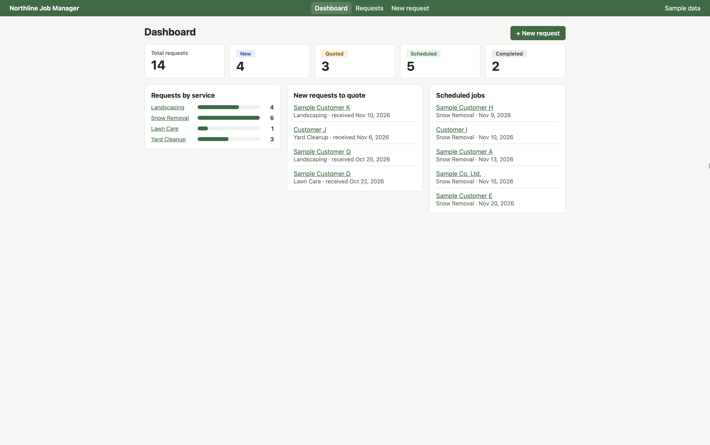 | 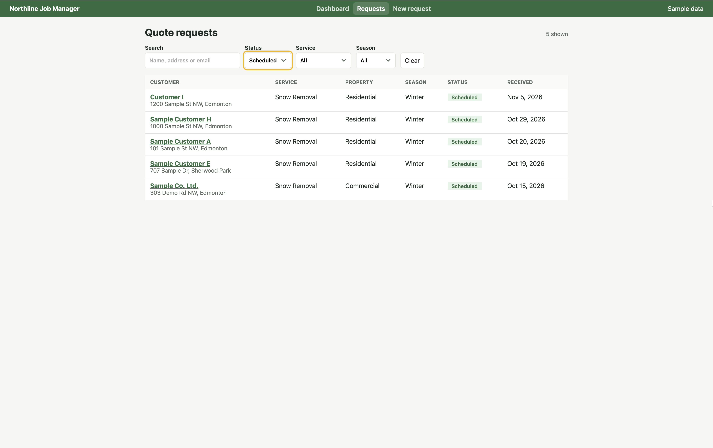 |

| Request details | New request |
|---|---|
| 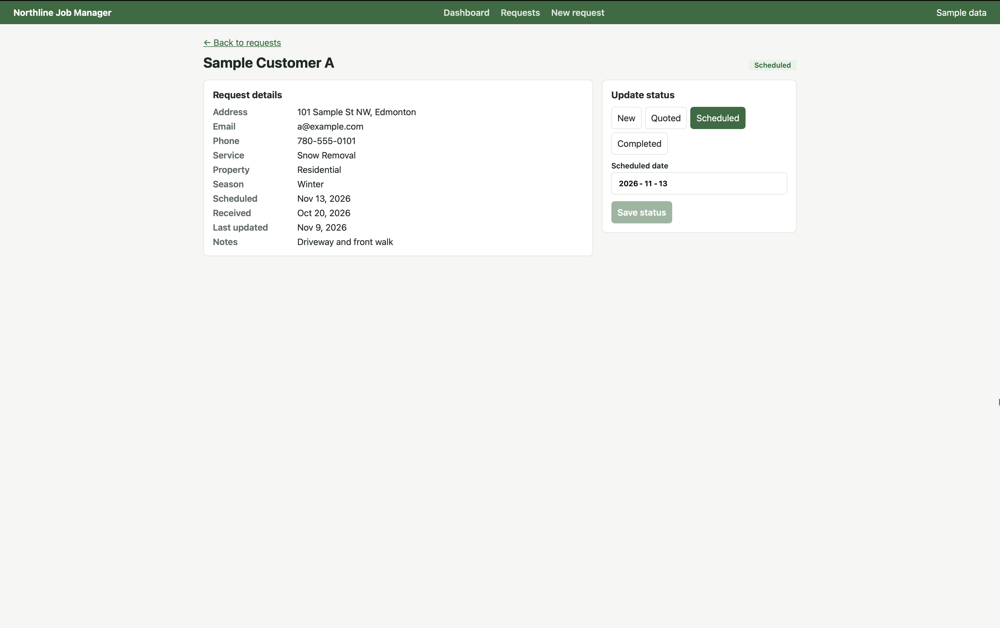 |  |

## Features

All three frontends have the same features:

- Dashboard with status counts, requests by service, new requests to quote and scheduled jobs
- Request list with search and filters (status, service, season), kept in the URL
- Request details with status updates (Scheduled and Completed need a date)
- New request form with validation in the browser and in the API
- Accessibility: labelled fields, errors linked to fields, keyboard friendly, skip link, visible focus, unique page titles

## Tech stack

| Layer | Technology |
|---|---|
| Database | Azure SQL Database, T-SQL (CHECK constraints, defaults, index) |
| API | ASP.NET Core Web API (.NET 10), Entity Framework Core, Swagger/OpenAPI |
| Frontend (React) | React, TypeScript, Vite, React Router, ESLint |
| Frontend (Blazor) | Blazor WebAssembly (.NET 10), C#, EditForm with data-annotation validation |
| Frontend (Angular) | Angular 22, TypeScript, standalone components, signals, RxJS, Reactive Forms, Vitest |

## Project structure

```
api/        ASP.NET Core Web API
database/   SQL script: table and sample data
react/      React + TypeScript frontend
blazor/     Blazor WebAssembly frontend (C#)
angular/    Angular frontend (TypeScript)
docs/       Screenshots
```

## API endpoints

| Method | Endpoint | Purpose |
|---|---|---|
| GET | `/api/quoterequests?search=&status=&serviceType=&season=` | List with search and filters |
| GET | `/api/quoterequests/{id}` | One request |
| POST | `/api/quoterequests` | Create (validated) |
| PATCH | `/api/quoterequests/{id}/status` | Change status and scheduled date |
| GET | `/api/quoterequests/summary` | Counts for the dashboard |

## Run it locally

You need the .NET 10 SDK, Node.js (LTS, for React and Angular) and a SQL Server or Azure SQL database.

1. **Database:** run `database/01_create_quote_requests.sql`.
2. **API:**
   ```bash
   cd api
   dotnet user-secrets set "ConnectionStrings:NorthlineDb" '<your connection string>'
   dotnet run
   ```
   Swagger: `http://localhost:5280/swagger`
3. **React:**
   ```bash
   cd react
   npm install
   npm run dev
   ```
   Open `http://localhost:5173`. The API address is set in `react/.env.development`.
4. **Blazor:**
   ```bash
   cd blazor
   dotnet watch
   ```
   Open the address shown in the terminal. The API address is set in `blazor/wwwroot/appsettings.Development.json`, and the Blazor address must be in the API's CORS list (`api/appsettings.Development.json`).
5. **Angular:**
   ```bash
   cd angular
   npm install
   npm start
   ```
   Open `http://localhost:4200`. The API address is set in `angular/src/environments/environment.development.ts`. Run the unit tests with `npm test`.

## Design decisions

- **Validation in three layers:** the frontend for instant feedback, API DTO validation for clear 400 messages, SQL CHECK constraints as the final safety net.
- **Times stored in UTC** and sent with a `Z`, so each browser shows its own local time.
- **Typed API client in one place** (`react/src/api`, `blazor/Services`, `angular/src/app/services`), with readable error messages for any error shape.
- **Blazor service behind an interface** (`IQuoteRequestService`), so pages depend on what it does, not how, and it can be replaced with a fake in tests.
- **Blazor WebAssembly (standalone)** rather than Blazor Server, so it runs in the browser and calls the API like the React app, which makes the two directly comparable.
- **Angular pages lazy-loaded** with `loadComponent`, so each page's code downloads only when it's opened.
- **Search requests cancelled when outdated:** a newer search cancels the older one (React: ignore flag, Blazor: `CancellationToken`, Angular: RxJS `switchMap`).
- **CSS-only bar chart** instead of a chart library, since a few bars don't need the extra download.
- **Secrets** kept in user-secrets, never in the repo. Frontend settings files hold only the API address, because anyone can read them in the browser.

## React vs Blazor vs Angular

All three frontends have the same pages and call the same API, so they can be compared directly.

| | React | Blazor WebAssembly | Angular |
|---|---|---|---|
| Language | TypeScript + JSX | C# + Razor | TypeScript + HTML templates |
| What it is | Library for the view; add-ons for routing and forms | .NET framework | Full framework with routing, forms, HTTP and DI built in |
| Validation | Own validation function, mirrored from the API | Same data-annotation attributes as the API (`EditForm`) | Reactive Forms with built-in and custom validators |
| State | `useState` + setter | Plain C# fields | Signals (`signal`, `computed`) |
| Search debounce and cancel | `setTimeout` + ignore flag | `Task.Delay` + `CancellationToken` | RxJS `debounceTime` + `switchMap` |
| Routing | React Router library | Built in (`@page`) | Built in (route table, lazy loading) |
| First load | Small download | Larger (downloads .NET once, then cached) | Small download (about 80 kB) |
| Best fit | Teams working in JavaScript/TypeScript | .NET teams sharing C# code between API and UI | Large teams that want one standard structure |