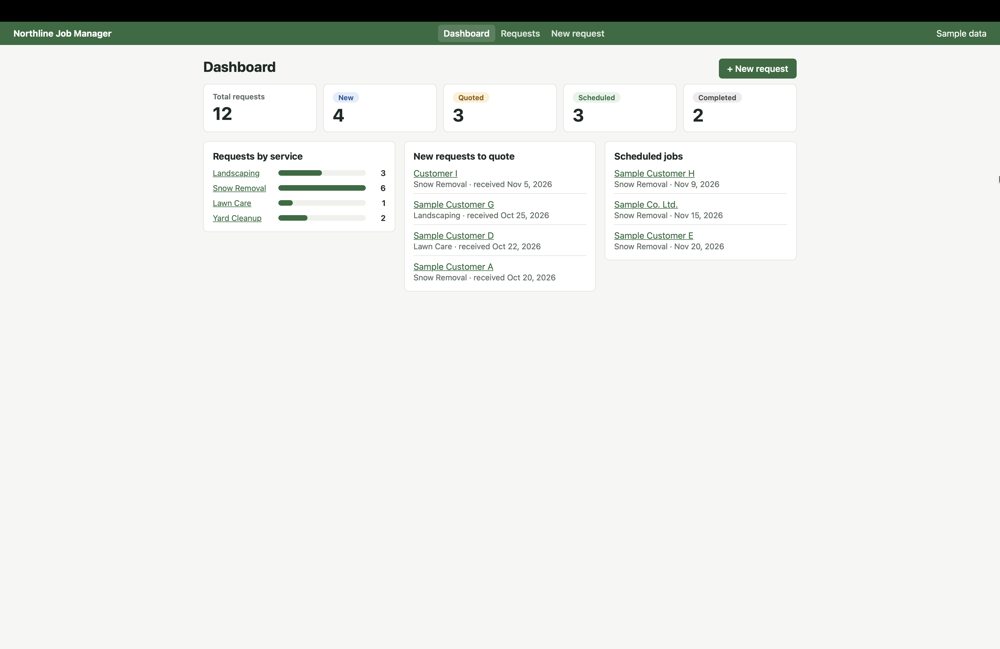
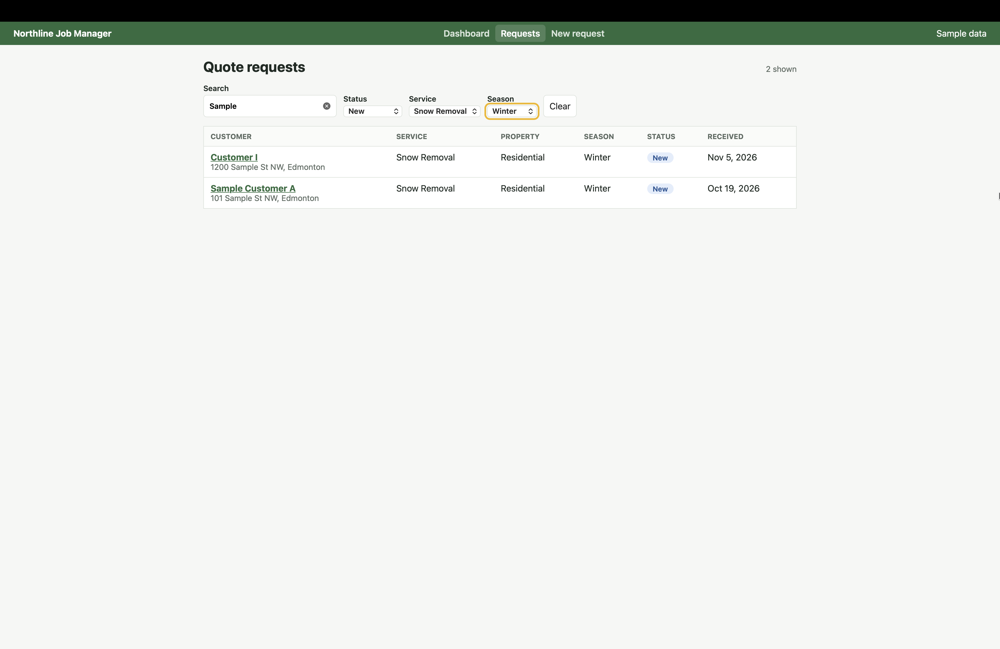
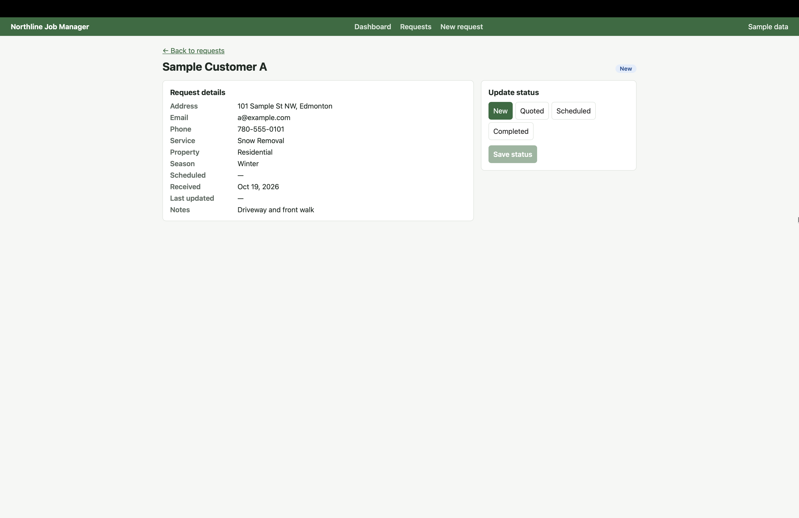
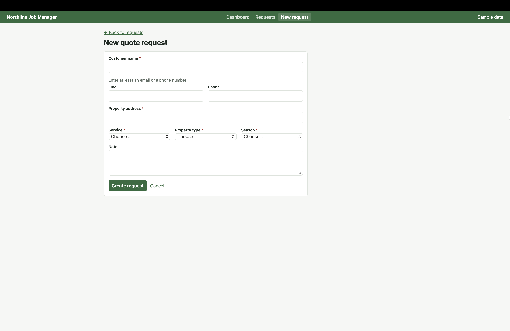

# Northline Job Manager

An internal tool for a fictional landscaping and snow-removal company to track customer quote requests.
Personal portfolio project. **All business names, customers and data are sample data.**

One ASP.NET Core Web API serves three frontends: **React (done)**, Blazor and Angular (in progress).

## Screenshots

| Dashboard | Requests |
|---|---|
|  |  |

| Request details | New request |
|---|---|
|  |  |

## Features

- Dashboard with status counts, requests by service, new requests to quote and scheduled jobs
- Request list with search and filters (status, service, season), kept in the URL
- Request details with status updates (Scheduled and Completed need a date)
- New request form with validation in the browser and in the API
- Accessibility: labelled fields, errors linked to fields, keyboard friendly, skip link, visible focus, unique page titles

## Tech stack

| Layer | Technology |
|---|---|
| Database | Azure SQL Database, T-SQL (CHECK constraints, defaults, index) |
| API | ASP.NET Core Web API (.NET 10), Entity Framework Core, Swagger/OpenAPI |
| Frontend | React, TypeScript, Vite, React Router, ESLint |

## Project structure

```
api/        ASP.NET Core Web API
database/   SQL script: table and sample data
react/      React + TypeScript frontend
blazor/     coming soon
angular/    coming soon
```

## API endpoints

| Method | Endpoint | Purpose |
|---|---|---|
| GET | `/api/quoterequests?search=&status=&serviceType=&season=` | List with search and filters |
| GET | `/api/quoterequests/{id}` | One request |
| POST | `/api/quoterequests` | Create (validated) |
| PATCH | `/api/quoterequests/{id}/status` | Change status and scheduled date |
| GET | `/api/quoterequests/summary` | Counts for the dashboard |

## Run it locally

You need the .NET 10 SDK, Node.js (LTS) and a SQL Server or Azure SQL database.

1. **Database:** run `database/01_create_quote_requests.sql`.
2. **API:**
   ```bash
   cd api
   dotnet user-secrets set "ConnectionStrings:NorthlineDb" '<your connection string>'
   dotnet run
   ```
   Swagger: `http://localhost:5280/swagger`
3. **React:**
   ```bash
   cd react
   npm install
   npm run dev
   ```
   Open `http://localhost:5173`. The API address is set in `react/.env.development`.

## Design decisions

- **Validation in three layers:** React for instant feedback, API DTO validation for clear 400 messages, SQL CHECK constraints as the final safety net.
- **Times stored in UTC** and sent with a `Z`, so each browser shows its own local time.
- **Typed API client** in one place (`react/src/api`), with readable error messages for any error shape.
- **CSS-only bar chart** instead of a chart library, since a few bars don't need the extra download.
- **Secrets** kept in user-secrets, never in the repo.
